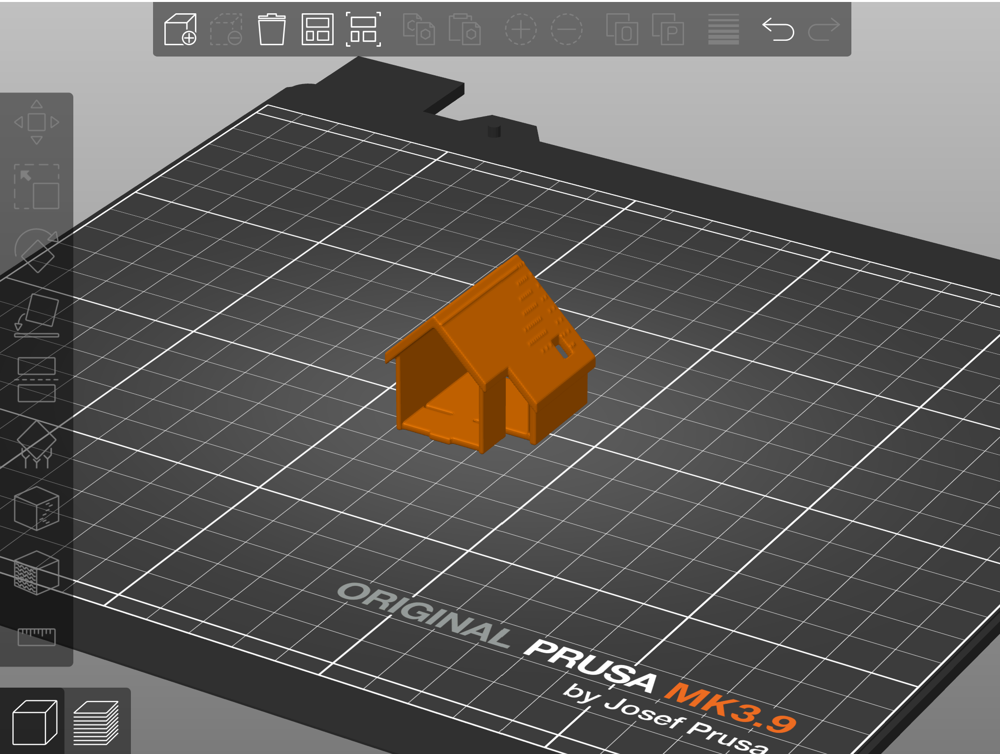

# IFC2Print – Massstabsmodell-Generator

**Modul:** Digital Twin Programmieren (TA.BA_DT_PROGR), HSLU Digital Construction, HS26  
**Autor:** Gian Blaser · Einzelarbeit

Prüft ein IFC-Modell für einen wählbaren Massstab und ein Druckerprofil (Referenz Prusa MK4, 0.4-mm-Düse) auf Druckbarkeit, bereinigt es regelbasiert und erzeugt druckfertige STL/3MF-Dateien.

---

## Ausbaustufen

| Stufe | Inhalt | Status |
|-------|--------|--------|
| 0 | Machbarkeit: NEST → Meshes → Voxel-Hülle → STL | in Arbeit |
| 1 | Analyse, Massstab/Status, Regelwerk fix, Streamlit-UI | geplant |
| 2 | Regelwerk SQLite, Report, Fensterfüllung-Toggle | geplant |
| 3 | Geschossweise Aufteilung, Steckverbinder, 3MF | geplant |
| 4 | 3D-Vorschau mit Statusfarben | optional |
| 5 | Boolesche Variante (manifold3d) | optional |

---

## Einrichten

```bash
cd 03_IFC2Print
python -m venv .venv
.venv\Scripts\activate        # Windows
pip install -r requirements.txt
```

IFC-Testdatei (`ARC_Modell_NEST_230328.ifc`) in `testdaten/` ablegen.

---

## Stufe 0 – Machbarkeitstest

```bash
python scripts/stufe0_machbarkeit.py
```

Erzeugt `output/Rohnetz_P0_V##.stl` und `output/Box_1_200_P0_V##.stl`.

### Messwerte – ARC_Modell_NEST_230328.ifc (12.10.2026)

| Kennzahl | Wert |
|----------|------|
| Schema / Bauteile | IFC2X3 / 1206 |
| Laufzeit Triangulierung | 6.9 s |
| Laufzeit Voxel-Hülle | 461.7 s |
| Gesamtlaufzeit | 469.0 s |
| Meshes trianguliert / ohne Geometrie | 72 / 592 |
| BBox Rohnetz (mm) | 244.2 × 217.7 × 126.9 |
| Voxelmatrix | 614 × 548 × 321 |
| Gefüllte Voxel | 4 714 030 |
| RAM (Bool-Array) | 108.0 MB |
| Faces Hülle | 5 219 520 |
| Wasserdicht | Ja |

**Go/No-Go (18.10.2026):** –

### PrusaSlicer-Vorschau




---

## Tests

```bash
pytest tests/
```

---

## Projektstruktur

```
03_IFC2Print/
├─ app.py            # Streamlit-UI (ab Stufe 1)
├─ config.py         # Defaultwerte
├─ core/             # Fachmodule (aktive Stufen 0–1)
├─ scripts/          # Stufe-0-Skript (ruft core/ auf, misst Laufzeiten)
├─ _parkiert/        # Code für Stufe 2–3 (db/, aufteilung, export) – siehe _parkiert/README.md
├─ testdaten/        # IFC-Dateien (nicht im Repo)
├─ output/           # Generierte STL/3MF (nicht im Repo)
└─ tests/            # pytest
```
